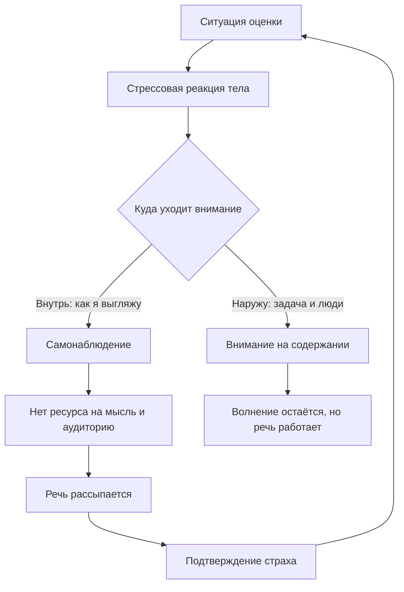

# Страх публичного выступления — что о нём известно

## Вопрос

Почему перед выступлением колотится сердце и пропадают слова — и что из
предложенных способов это убрать реально работает, а что фольклор.

## Короткий ответ

Волнение перед аудиторией — не поломка, а нормальная реакция организма на
ситуацию, где тебя оценивают. Главная ошибка — пытаться её **убрать**:
попытки «успокоиться» усиливают самонаблюдение, а именно оно и ломает речь
(S-010). Работает другое: перевести внимание наружу (на аудиторию и
задачу), снизить ставку и довести подготовку до автоматизма. Из
практических приёмов надёжнее всего те, что меняют не эмоцию, а **фокус
внимания** и **объём подготовки**. Слушатели при этом замечают твоё
волнение гораздо хуже, чем кажется изнутри (S-011).

## Что известно

### Волнение — это реакция на оценку, а не на сцену

Организм реагирует не на микрофон, а на ситуацию социальной оценки.
Запускается стандартная стрессовая реакция: учащается пульс, дыхание
становится поверхностным, кровь уходит от периферии. Эта реакция
краткосрочно полезна — она мобилизует (S-048).

Проблема начинается, когда реакция затягивается и человек начинает
обслуживать её, а не задачу.

### Главный механизм: внимание разворачивается внутрь

Самое точное объяснение даёт когнитивная модель социальной тревоги: в
момент опасности человек перестаёт смотреть наружу и начинает наблюдать
за собой — как я выгляжу, не дрожит ли голос, что обо мне думают (S-010).

Дальше — замкнутый круг:

1. Внимание уходит на самонаблюдение.
2. Ресурса на восприятие аудитории и на собственную мысль не остаётся.
3. Речь действительно рассыпается.
4. Это подтверждает страх: «я и правда не умею».

Отсюда главный практический вывод: цель не «перестать волноваться», а
**развернуть внимание наружу**. Волнение при этом может остаться — и это
нормально.

### Со стороны волнение почти не видно

Люди систематически переоценивают, насколько окружающие замечают их
промахи и состояние — эффект прожектора (S-011). Пауза, которая изнутри
кажется вечностью, снаружи выглядит как обычная пауза.

Это не утешение, а рабочий инструмент: если знать, что дрожь в голосе
слышна в разы хуже, чем изнутри, исчезает смысл её прятать — а значит,
уходит часть самонаблюдения.

### Что говорит театральная школа

Кит Джонстон формулирует жёстче, чем психологи: спонтанность блокируется
не отсутствием способностей, а страхом оценки — человек отбрасывает
первые идеи как «недостаточно хорошие» и остаётся ни с чем (S-017).
Лекарство у него практическое: снизить ставку и разрешить себе банальный
ответ.

Это совпадает с когнитивной моделью, но приходит с другой стороны — от
сценической практики, а не от клиники.

### Что говорят классические руководства по риторике

Пособия начала XX века, которые сегодня свободно доступны, на удивление
современны в одном пункте: они почти не обсуждают «борьбу с волнением», а
обсуждают **подготовку и повторение**. Кляйзер строит обучение вокруг
ежедневных коротких упражнений и разбора чужих речей (S-056). Стрэттон
начинает не с уверенности, а с устройства речи: план, переходы, дыхание,
громкость (S-057).

Логика простая: чем больше в выступлении автоматизма, тем меньше ресурса
нужно в моменте — и тем меньше остаётся на панику.

Современная практика говорит то же: регулярные выступления в безопасной
группе важнее теории (S-022).

## Схема

Петля слева — замкнутый круг самонаблюдения. Выход один: переключить
внимание на правой развилке, а не пытаться убрать реакцию тела.

## Что делать

1. **Перестать ставить цель «не волноваться».** Цель — донести мысль.
   Волнение может ехать рядом.
2. **Дать внимание наружу.** Самое простое — найти в зале три-четыре лица
   и говорить им по очереди. Это физически мешает смотреть внутрь себя.
3. **Готовить не текст, а каркас.** Три опорных пункта, которые помнишь
   без бумажки. Заученный дословно текст разваливается первым.
4. **Проговорить вслух минимум три раза.** Не «прочитать глазами».
   Автоматизм освобождает ресурс (S-056, S-057).
5. **Выучить наизусть только первые две фразы.** Самый тревожный момент —
   старт; дальше включается подготовка.
6. **Не извиняться за волнение.** Это сообщение аудитории «следите за моим
   состоянием» — ровно то, чего мы избегаем.
7. **Искать регулярную безопасную практику** — кружок, рабочие планёрки,
   любой формат, где можно выступать часто и без последствий (S-022).

## Противоречия и пробелы

- **Психология и театральная школа не спорят, но говорят на разных
  языках.** Клиническая модель (S-010) объясняет механизм, Джонстон
  (S-017) даёт практику. ~~Прямых исследований нет.~~ **Обновлено
  2026-11-06:** такие исследования нашлись. Курс импровизационного
  театра снижает социальную тревогу с большим размером эффекта (S-060),
  а двадцать минут упражнений повышают терпимость к неопределённости
  (S-061). То есть театральный путь к снижению страха перед аудиторией
  имеет измеренное подтверждение — с оговорками по дизайну, разобранными
  в статье A-004.
- **Классические риторики (S-056, S-057) — это опыт, а не данные.**
  Им по сто лет, выборок нет, эффективность не измерялась. Берём из них
  структуру подготовки, а не утверждения о психике.
- **Toastmasters (S-022) — заинтересованная сторона:** организация
  продвигает собственный формат.
- **Пробел:** нет источников по физиологии голоса при волнении (тема T-09
  пока пустая) и по тому, что именно аудитория реально замечает.
- **Непроверено:** популярный совет «представь зал в смешном виде» ни в
  одном из собранных источников не встречается. Похоже на фольклор.

## Источники

| Код | Источник | Что взято |
|---|---|---|
| S-010 | Clark & Wells, когнитивная модель социальной фобии, 1995 | механизм разворота внимания внутрь |
| S-011 | Gilovich et al., эффект прожектора, 2000 | волнение снаружи заметно хуже |
| S-017 | Johnstone, «Impro», 1979 | страх оценки блокирует спонтанность |
| S-022 | Toastmasters International, учебные материалы | регулярная практика в безопасной группе |
| S-048 | Сапольски, «Психология стресса», 2004 | физиология острой реакции |
| S-056 | Kleiser, «The Training of a Public Speaker», 1920 | ежедневные упражнения, разбор чужих речей |
| S-057 | Stratton, «Public Speaking», 1920 | план речи, дыхание, громкость |

## История правок

| Дата | Что изменилось | Почему |
|---|---|---|
| 2026-11-05 | Статья создана | первая статья читальни, образец формата |
| 2026-11-06 | Переписан пункт о нехватке исследований театральных приёмов | найдены S-060 и S-061: импровизация снижает тревогу, есть измерения |
