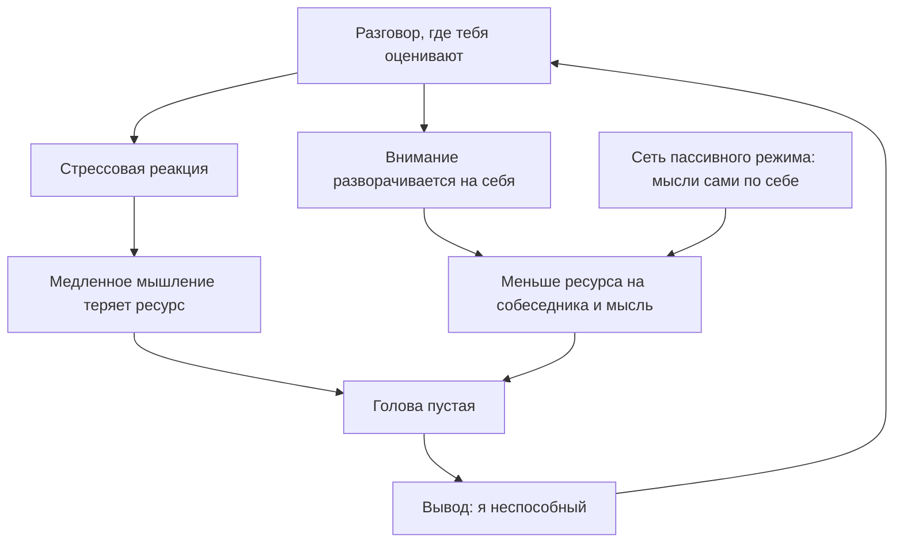

# Почему в разговоре пустеет голова

## Вопрос

Человек всё слышит и понимает, но ответить не может: мыслей нет. Нужная
фраза приходит через пять минут. Что это такое с точки зрения того, как
работает мозг, и можно ли на это повлиять.

## Короткий ответ

Это не дефект личности и не медленный ум. Складываются три вещи: мозг по
умолчанию уходит в собственные мысли (S-001), внимание в момент оценки
разворачивается на себя вместо собеседника (S-010), а стресс забирает
ресурс у той части мышления, которая требует усилия (S-043, S-048).
Влиять проще всего на третье и второе: снизить физическое возбуждение
дыханием (S-004) и перевести внимание наружу. «Разогнать мозг» нельзя —
и не нужно.

## Что известно

### Блуждание мыслей — это режим по умолчанию

Когда человек не занят внешней задачей, включается сеть пассивного режима:
мозг начинает производить собственные мысли, не связанные с тем, что
происходит вокруг (S-001). Это не сбой, а базовая настройка.

Насколько часто это происходит, показал масштабный опрос в реальном
времени: мысли уходят от текущего занятия примерно в половине замеров
(S-002). То есть «я отвлёкся» — это нормальное состояние половины жизни,
а не личный недостаток.

Важная деталь: человек обычно **не замечает**, что отвлёкся, — заметить
это отдельный навык (S-008). Поэтому изнутри кажется, что голова опустела
внезапно, хотя ум уехал на полминуты раньше.

### Внимание уходит внутрь — и ресурса не остаётся

Второй слой — социальный. Когда есть ощущение, что тебя оценивают,
внимание разворачивается на себя: как я выгляжу, что обо мне подумают,
не глупость ли я сейчас скажу (S-010).

Беда в том, что внимание — ресурс конечный. Если половина уходит на
самонаблюдение, на собеседника и на собственную мысль остаётся вторая
половина. Отсюда ощущение тумана: ты вроде слушаешь, но не удерживаешь.

### Стресс отключает именно медленное мышление

Третий слой — физиология. Острая стрессовая реакция мобилизует тело, но
бьёт по сложным функциям: страдает то мышление, которое требует усилия и
удержания нескольких вещей в голове (S-048).

Быстрое мышление при этом работает: оно опирается на готовые шаблоны
(S-043). Отсюда практический вывод, который часто формулируют неверно.
Люди, которые «быстро соображают», обычно не думают быстрее — у них
больше готовых заготовок, которые не требуют медленного мышления.

### Что из этого поддаётся влиянию

| Слой | Можно ли повлиять | Чем |
|---|---|---|
| Блуждание мыслей | Частично | заметить и вернуться; практика внимания |
| Внимание на себе | Да | перевести фокус на собеседника и задачу |
| Стрессовая реакция | Да, быстро | дыхание с длинным выдохом (S-004) |
| «Скорость мозга» | Нет | это миф; работают заготовки, а не разгон |

## Схема

Три входа в одно состояние: физиология, самонаблюдение и фоновое
блуждание мыслей. Снизу — петля, которая делает проблему устойчивой.

## Что делать

1. **Снять физику.** Два коротких вдоха носом, долгий выдох ртом, 3–5 раз.
   Это самый быстрый способ сбить возбуждение (S-004).
2. **Развернуть внимание наружу.** Задать собеседнику вопрос и слушать
   ответ по-настоящему. Вопрос решает две задачи: даёт время и
   переключает фокус с себя на него.
3. **Перестать ждать блестящего ответа.** Ответ по делу лучше, чем
   остроумный, но поздний. Требование блеска — главный источник ставки.
4. **Копить заготовки, а не скорость.** Готовые схемы ответа и несколько
   своих историй работают там, где медленное мышление отключается (S-043).
5. **Заметить, что отвлёкся, — уже результат.** Возврат внимания и есть
   навык, а не признак провала (S-008).
6. **Разобраться со сном.** Если спишь мало, разговоры — не первая
   проблема, которую надо чинить.

## Противоречия и пробелы

- **Источники описывают механизмы, но не лечение.** S-001, S-002, S-008 —
  это про то, как работает внимание, а не про то, как лучше общаться.
  Перенос на разговор — наша интерпретация, а не вывод авторов.
- **S-010 — клиническая модель социальной фобии.** У здорового человека с
  обычным волнением механизм, скорее всего, тот же, но выраженный слабее.
  Прямых данных по «обычной застенчивости» в библиотеке нет.
- **Дыхательная практика (S-004) проверялась не в разговоре**, а в
  спокойных условиях, с ежедневным применением месяц. Что она работает
  прямо посреди беседы — правдоподобно, но не доказано.
- **Пробел:** нет ни одного источника, который измерял бы «скорость
  находчивости» и её тренируемость. Это самая важная для темы дыра.

## Источники

| Код | Источник | Что взято |
|---|---|---|
| S-001 | Мейсон и др., «Блуждающий ум», 2007 | сеть пассивного режима как норма |
| S-002 | Киллингсворт и Гилберт, 2010 | ум блуждает половину времени |
| S-004 | Балбан и др., 2023 | дыхание с длинным выдохом снижает возбуждение |
| S-008 | Смолвуд и Шулер, «Беспокойный ум», 2006 | человек не замечает, что отвлёкся |
| S-010 | Кларк и Уэллс, когнитивная модель, 1995 | внимание разворачивается на себя |
| S-043 | Канеман, «Думай медленно… решай быстро», 2011 | быстрое мышление работает на шаблонах |
| S-048 | Сапольски, «Психология стресса», 2004 | стресс бьёт по сложным функциям |

## История правок

| Дата | Что изменилось | Почему |
|---|---|---|
| 2026-11-05 | Статья создана | базовая статья темы T-01 |
