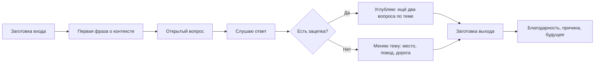

# С чего начать разговор с незнакомым человеком

## Вопрос

Что конкретно сказать первым и почему это так страшно, если сказать
нужно буквально три слова.

## Короткий ответ

Начало разговора — не талант, а последовательность действий, которую
можно выучить (S-013). Страшно потому, что человек переоценивает, как
пристально его разглядывают (S-011), и боится застрять. Поэтому
начинающему нужны две заготовки, а не одна: **как войти** и **как выйти**.
Содержание первой фразы почти не имеет значения — работает сам факт, что
ты заговорил первым и этим снял неловкость с обоих.

## Что известно

### Ответственность за начало берёт на себя один человек

Базовая мысль всех практических руководств: в любой паре незнакомцев оба
ждут, что начнёт другой. Тот, кто заговорил первым, воспринимается не как
навязчивый, а как доброжелательный — он решил общую проблему (S-013).

Карнеги формулирует то же старее и проще: интерес к собеседнику сильнее,
чем попытка быть интересным (S-030). Источник 1936 года и без всякой
эмпирики, но эту мысль повторяют все, кто писал после него.

### Почему это работает: симпатия строится на внимании и сходстве

Механизм описан в работах о влиянии: люди лучше относятся к тем, кто
похож на них и кто проявил к ним интерес, а любая реплика запускает
взаимность — на вопрос хочется ответить и спросить в ответ (S-041).

То есть первая фраза не должна быть остроумной. Её задача — запустить
обмен.

### Открытый вопрос против закрытого

Самая практичная деталь из всех источников. Сравни:

- «Нравится?» → «Да». Разговор кончился.
- «Что думаешь?» → развёрнутый ответ, из которого видно, за что
  зацепиться дальше.

Закрытый вопрос закрывает, открытый открывает (S-013). Это звучит
банально ровно до того момента, когда начинаешь считать свои вопросы и
обнаруживаешь, что почти все они закрытые.

### Темы: не искать уникальное, брать общее

Русскоязычные руководства сходятся в том же, в чём и англоязычные: темы
берутся из того, что у вас обоих есть прямо сейчас (S-040). Место,
событие, дорога, еда, повод мероприятия. Общий опыт важнее интересной
темы.

Отдельно — про уместность: вопрос считается нормальным, если ты сам готов
на него ответить. Это единственный надёжный фильтр.

### Главный страх — не начать, а застрять

Люди систематически переоценивают, насколько окружающие замечают их
неловкость (S-011). Но за страхом начать обычно стоит другой страх: что
разговор затянется и выйти будет невозможно.

Поэтому выход готовится заранее, вместе с входом. Формула простая:
благодарность → причина → будущее. «Было интересно, пойду возьму кофе,
ещё увидимся». Спокойный выход оставляет лучшее впечатление, чем
десять минут вымученной беседы.

## Схема

Вход и выход — две половины одного навыка. Без второй половины первая не
используется.

## Что делать

1. **Выбери одну фразу входа и используй только её** неделю. Проще всего:
   вопрос про контекст («вы тоже на этот доклад?»).
2. **Считай свои вопросы.** Цель — чтобы открытых было больше, чем
   закрытых. Это измеримо.
3. **После ответа реагируй, потом спрашивай.** Без реакции получается
   допрос: вопрос — ответ — вопрос.
4. **Три вопроса по одной теме, а не три темы.** Глубина даёт контакт,
   перескоки — нет.
5. **Выучи фразу выхода наизусть.** Она снимает страх входа.
6. **Считай успехом факт разговора, а не его качество.** Две реплики с
   каждой стороны — уже выполнено.

## Противоречия и пробелы

- **Практически все источники темы — это опыт, а не исследования.**
  S-013, S-030, S-040 — руководства; данных об эффективности приёмов нет.
  Единственная научная опора здесь косвенная: S-011 и S-041.
- **S-030 устарел по тону.** Советы 1936 года местами звучат как
  манипуляция; берём только базовую мысль об интересе к собеседнику.
- **S-040 — сборная категория** русскоязычных статей разного качества,
  без авторства. Статус «на проверке» не случаен.
- **Культурный пробел:** почти все рекомендации американские. Насколько
  уместна беседа с незнакомцем в российском контексте — отдельный
  вопрос, источников по нему нет.
- **Не проверено:** утверждение «содержание первой фразы неважно» звучит
  во многих руководствах, но измерений этому не нашлось.

## Источники

| Код | Источник | Что взято |
|---|---|---|
| S-011 | Гилович и др., эффект прожектора, 2000 | неловкость заметна хуже, чем кажется |
| S-013 | Дебра Файн, «Тонкое искусство светской беседы», 2005 | заходы, открытые вопросы, выход |
| S-030 | Карнеги, «Как завоёвывать друзей», 1936 | интерес к собеседнику важнее собственной интересности |
| S-040 | Русскоязычные статьи о small talk | темы-спасатели, проверка уместности |
| S-041 | Чалдини, «Психология влияния», 1984 | симпатия, сходство, взаимность |

## История правок

| Дата | Что изменилось | Почему |
|---|---|---|
| 2026-11-05 | Статья создана | базовая статья темы T-02 |
