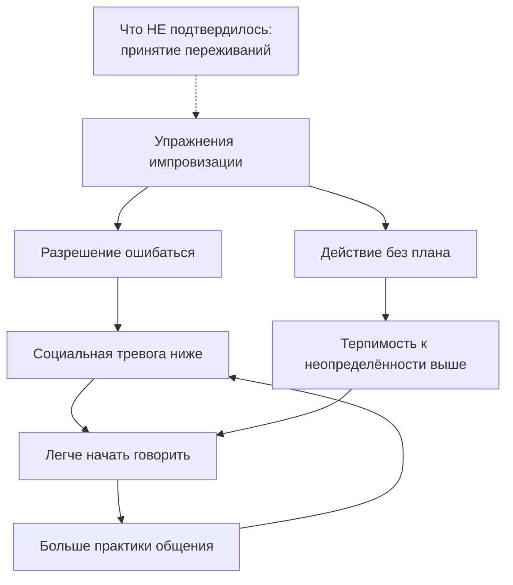

# Работает ли импровизация — что показывают исследования

## Вопрос

Школы импровизации обещают раскрепощение, находчивость и лёгкость в
общении. Это маркетинг или за этим есть проверяемый эффект?

## Короткий ответ

Эффект есть, и он измерен. Курс импровизационного театра заметно снижает
социальную тревогу: после программы 43 % подростков с положительным
скринингом на социофобию перестали его проходить, размер эффекта большой
(S-060). Двадцати минут упражнений хватает, чтобы вырос показатель
гибкости мышления и терпимости к неопределённости (S-061). При этом не
подтвердилось всё подряд: в контролируемом исследовании выросли
креативность и самооценка, а вот «принятие» не изменилось (S-062).
Выборки маленькие, отсев большой, взрослых почти не изучали — так что
это «работает», а не «доказано окончательно».

## Что известно

### Самое сильное свидетельство: тревога падает

Исследование на 266 школьниках из десяти школ: десятинедельная программа
импровизационного театра. У тех, кто в начале проходил скрининг на
социальную фобию, к концу симптомы снизились настолько, что 43 % больше
скрининг не проходили. Размер эффекта d ≈ 0,95 — это много (S-060).

Вместе с тревогой выросли самооценка социальных навыков, ощущение
надежды, вера в собственную креативность и — отдельный пункт —
**готовность ошибаться**.

Важная деталь: чем активнее человек участвовал, тем сильнее был эффект.
Пассивное присутствие не работает.

### Эффект виден уже через двадцать минут

Это, пожалуй, самое полезное для практики. В двух экспериментах с
контрольной группой (n = 74 и n = 131) двадцать минут импровизационных
упражнений повысили показатели дивергентного мышления — способности
выдавать много разных идей, — а также терпимость к неопределённости и
эмоциональное состояние (S-061).

Терпимость к неопределённости здесь важнее, чем «креативность». Именно
она отвечает за способность начать фразу, не зная, чем закончишь, — то,
чего не хватает человеку с «пустой головой».

### Работает не всё, что обещают

Шестинедельный курс с контрольной группой: креативность и психологическое
благополучие выросли, самооценка и самоэффективность тоже. А гипотеза о
росте «принятия» (способности принимать неприятные переживания) не
подтвердилась (S-062).

Это честный результат, и он полезен: импровизация — не универсальная
терапия. Она тренирует конкретные вещи: гибкость, спонтанность,
готовность к неожиданному.

### Что говорят практики — и совпадает ли это с данными

Практические книги говорили то же самое задолго до исследований:

- принять реплику партнёра и добавить своё, а не отрицать (S-014);
- слушать важнее, чем придумывать смешное (S-015);
- спонтанность блокирует страх оценки, а не отсутствие идей (S-017).

Последний пункт особенно хорошо согласуется с данными: если курс снижает
именно тревогу и повышает готовность ошибаться (S-060), значит, Джонстон
был прав в механизме — убираем страх, спонтанность появляется сама.

### Чего в данных нет

Ни одно из исследований не измеряло то, что человек обычно хочет:
«стал ли я интереснее в компании». Мерили тревогу, гибкость мышления,
самооценку. Это смежные вещи, но не одно и то же.

## Схема

Петля работает в плюс: чем меньше страх, тем больше практики, тем меньше
страх. Пунктиром — то, что проверяли и не нашли.

## Что делать

1. **Главное — регулярность, а не длительность.** Двадцать минут дают
   измеримый эффект (S-061). Ежедневные двадцать минут лучше, чем раз в
   месяц по три часа.
2. **Участвовать активно.** Эффект зависит от вовлечённости (S-060).
   Наблюдать со стороны бессмысленно.
3. **Тренировать разрешение ошибаться, а не остроумие.** В исследованиях
   растёт именно готовность к ошибке — она и есть рабочий механизм.
4. **Начинать с упражнений на скорость, а не на качество.** Минута речи
   без остановки о бессмысленном предмете — ровно тот формат, который
   проверяли.
5. **Не ждать, что уйдут все переживания.** Принятие неприятных эмоций
   импровизация не тренирует (S-062). Она даёт действовать вместе с ними.
6. **Если тревога сильная — это не замена помощи.** Пилотное
   исследование с тревогой и депрессией показало средний эффект, но это
   пилот без контроля (S-063).

## Противоречия и пробелы

- **Главная слабость — дизайн исследований.** В S-060 нет контрольной
  группы, а отсев составил 45,5 %: половина участников до конца не
  дошла. Те, кому не помогало, могли просто уйти — это завышает эффект.
- **Почти все данные про подростков.** S-060 и S-064 — школьники.
  Взрослый человек в компании коллег — другая ситуация.
- **Одна исследовательская группа.** S-060, S-061 и S-064 — это команда
  Фелсмана. Независимого воспроизведения пока нет, а S-062 (другая
  группа) подтвердила не всё.
- **Лаборатория против жизни.** Дивергентное мышление в тесте — не то же
  самое, что находчивость в разговоре. Прямых измерений «стал ли человек
  лучше общаться» нет ни в одном источнике.
- **Не проверено:** сохраняется ли эффект через месяц после курса.
  Замеры делались сразу после.

## Источники

| Код | Источник | Что взято |
|---|---|---|
| S-014 | Кулхан, «Искусство „Да, и“», 2017 | принцип принятия реплики партнёра |
| S-015 | Леонард и Йортон, «„Да, и“», 2015 | слушание как главный навык |
| S-017 | Джонстон, «Импровизация и театр», 1979 | страх оценки блокирует спонтанность |
| S-060 | Фелсман и др., 2019 | снижение социальной тревоги, d ≈ 0,95 |
| S-061 | Фелсман и др., 2020 | 20 минут упражнений, гибкость и неопределённость |
| S-062 | Швенке и др., 2021 | что подтвердилось, а что нет |
| S-063 | Крюгер и др., 2017 | пилот по тревоге и депрессии |

## История правок

| Дата | Что изменилось | Почему |
|---|---|---|
| 2026-11-06 | Статья создана | найдены исследования импровизации — пробел темы T-04 закрыт |
