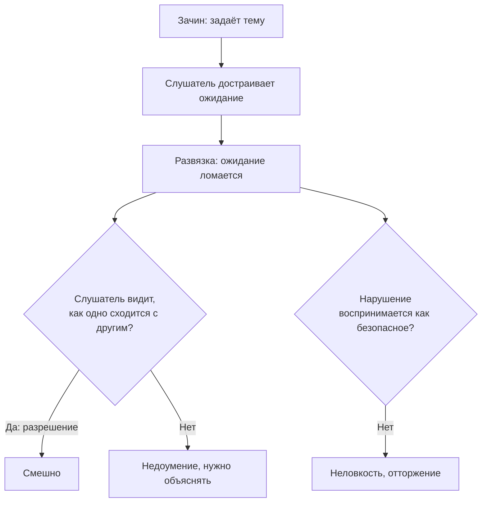

# Как устроен анекдот и почему он не всегда смешной

## Вопрос

Что отличает анекдот от просто смешной истории, из чего он состоит и
почему один и тот же текст у одного человека смешной, а у другого — нет.

## Короткий ответ

Анекдот — отдельный устный жанр со строгим устройством: две части (зачин
и развязка), без середины, и рассказчик **никогда не претендует на
авторство** (S-069). Смешно становится не от самого несоответствия, а от
его разрешения (S-066): слушатель должен успеть достроить ожидание и
увидеть, как оно переворачивается. Поэтому решают не слова, а подача:
анекдот — жанр «изобразительный», его показывают, а не пересказывают
(S-069). Универсальной теории смешного при этом нет: ни несообразность,
ни «безопасное нарушение» не отделяют удачные шутки от провальных
(S-068).

## Что известно

### Анекдот — не авторская шутка

Главное отличие, которое формулируют филологи Шмелёвы: в смешной истории
предполагается, что шутку придумал сам говорящий. В анекдоте наоборот —
рассказчик заведомо не автор и на авторство не претендует (S-069, S-070).

Из этого следует неочевидное практическое правило: **анекдот нельзя
«присваивать»**. Фразы вроде «я тут придумал» ломают жанр. Зато можно
смело начинать с «знаете анекдот про…» — это часть конвенции.

Второе следствие: рассказчик рассчитывает, что слушатели анекдота ещё не
слышали. Отсюда вечная проблема — «да знаю я его».

### Структура: две части, без середины

Анекдот состоит из зачина и развязки. У других юмористических жанров есть
ещё центральная часть — фабула; у анекдота её нет (S-069, S-071).

- **Зачин** задаёт тему и создаёт напряжение. Типичный русский зачин —
  глагол настоящего времени впереди подлежащего: «Едет ковбой по
  прерии…», «Приходит мужик к врачу…» (S-070).
- **Развязка** переворачивает ожидание.

Если между ними появляется развёрнутая середина — это уже не анекдот, а
байка. Отсюда главная ошибка рассказчика: добавлять подробности
«для красоты». Каждая лишняя деталь уводит ожидание не туда.

### Правило трёх — тот же механизм в миниатюре

Два однотипных элемента задают шаблон, третий его ломает (S-021). Это
самая короткая возможная форма «зачин — развязка»: двух повторов хватает,
чтобы слушатель достроил ожидание.

### Почему смешно: несоответствия мало

Классическое объяснение — теория несообразности: смешно, когда
происходящее расходится с ожиданием. Кулка показывает, что этого
объяснения не хватает: источник удовольствия не в самом несоответствии,
а в **его разрешении** (S-066). Несоответствие без разрешения вызывает не
смех, а тревогу или раздражение.

Отсюда прямое правило: панчлайн должен не просто удивлять, а давать
слушателю мгновенно понять, **как** одно сходится с другим. Если шутку
нужно объяснять — разрешения не произошло.

Есть и конкурирующие объяснения:

- **Безопасное нарушение** (S-025): смешно, когда норма нарушена, но
  нарушение воспринимается как безвредное. Отсюда граница уместного:
  слишком сильное нарушение вызывает отторжение, слишком слабое — скуку.
- **Разрешение несоответствия** (S-026): модель, из которой выросла
  формула «зачин — ожидание — слом».
- **Игровой режим**: слушатель должен согласиться играть. Без этого
  согласия самая выверенная шутка не работает.

### А универсальной теории всё-таки нет

Свежая работа проверила классические объяснения экспериментально: ни
несообразность, ни безопасное нарушение не отделили удачные шутки от
неудачных (S-068). Авторы предлагают свою теорию — «игры и веселья», где
важны игровой поворот и совпадение с мотивом слушателя.

Вывод для практика трезвый: формулы помогают строить шутку, но не
гарантируют, что она сработает. Проверка одна — живая аудитория.

### Жанр угасает

Шмелёвы отмечают, что эпоха анекдота заканчивается: он работал, пока было
общее культурное поле. Когда у всех разные ленты и сериалы, общих
отсылок почти не остаётся, и новые циклы анекдотов не появляются (S-071).

Практический смысл: ставка на «рассказать анекдот» сегодня слабее, чем
ставка на короткую смешную историю из своей жизни. История не требует,
чтобы собеседник знал контекст.

## Схема

Две развилки, на которых шутка проваливается: не произошло разрешения
или нарушение оказалось слишком сильным.

## Что делать

1. **Убрать середину.** Зачин и развязка. Любое предложение, которое не
   готовит слом, выкидывается.
2. **Не присваивать анекдот.** «Знаете анекдот про…» — это норма жанра,
   а не слабость.
3. **Держать паузу перед развязкой.** Слушателю нужно время достроить
   ожидание — без этого ломать нечего.
4. **Не объяснять после.** Объяснение — признак того, что разрешения не
   случилось; второй попытки у шутки нет.
5. **Проверять уместность по силе нарушения** (S-025). Вопрос не «смешно
   ли мне», а «воспримут ли это как безопасное здесь и сейчас».
6. **Работать с подачей, а не с текстом.** Анекдот — изобразительный
   жанр: интонация, жест, смена голоса персонажей (S-069). Один и тот же
   текст у разных людей звучит по-разному именно поэтому.
7. **Если сомневаешься — расскажи свою короткую историю.** Она не требует
   общего культурного контекста, который у анекдота уходит (S-071).

## Противоречия и пробелы

- **Теории юмора спорят между собой, и спор не решён.** S-066 говорит,
  что ключ в разрешении несоответствия; S-025 — что в безопасном
  нарушении; S-068 экспериментально показывает, что обе не справляются.
  Единой рабочей теории на сегодня нет.
- **S-068 — новая работа, два онлайн-эксперимента.** Её собственная
  теория пока не воспроизведена независимо. Мы используем её как
  возражение, а не как замену.
- **Русская и англоязычная традиции описывают разное.** Шмелёвы изучают
  анекдот как речевой жанр (кто, кому, при каких условиях); англоязычные
  источники — механику смешного в тексте. Прямого сопоставления в
  литературе не нашлось.
- **Пробел:** нет исследований, тренируется ли навык рассказывать
  анекдоты. Все рекомендации здесь — из практики, а не из экспериментов.
- **S-071 — популярная статья**, а её тезис о «смерти жанра» — мнение
  исследователей, а не измерение.

## Источники

| Код | Источник | Что взято |
|---|---|---|
| S-021 | Правило трёх в речи и письме | минимальная форма слома ожидания |
| S-025 | Макгроу и Уоррен, «Благожелательные нарушения», 2010 | граница уместного |
| S-026 | Салс, модель разрешения несоответствия, 1972 | механика «ожидание — слом» |
| S-066 | Кулка, «Несообразность теорий несообразности», 2007 | смешно от разрешения, а не от несоответствия |
| S-068 | «Теория игры и веселья», 2024 | критика обеих классических теорий |
| S-069 | Шмелёва и Шмелёв, «Русский анекдот», 2002 | жанр, структура, отказ от авторства |
| S-070 | Шмелёвы, «Серьёзно о смешном», 2003 | определение и типичный зачин |
| S-071 | «Нож», «Почему умирает анекдот?», 2021 | угасание жанра, отличие от смешной истории |

## История правок

| Дата | Что изменилось | Почему |
|---|---|---|
| 2026-11-06 | Статья создана | запрос на тему анекдотов; найдены Шмелёвы и свежая критика теорий юмора |
