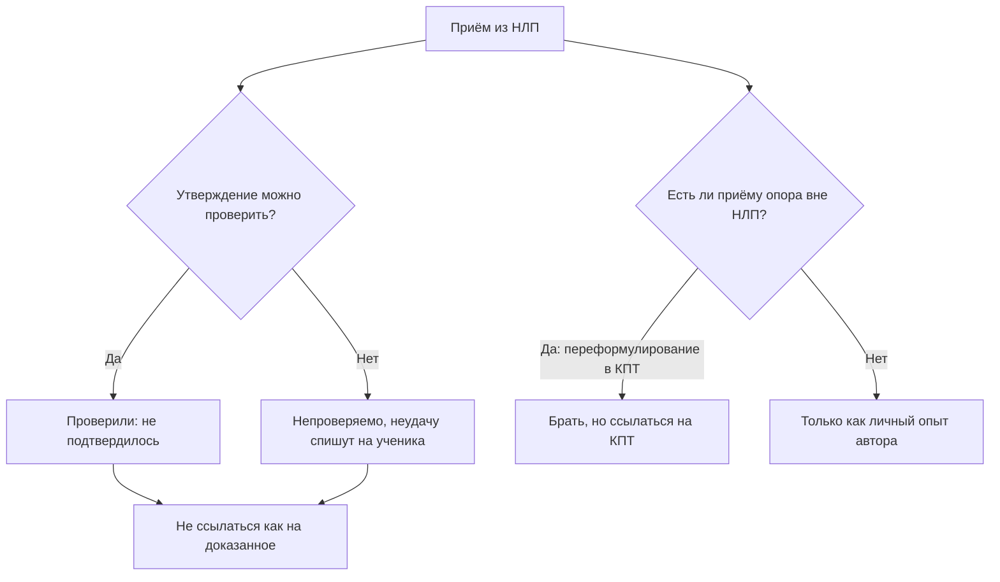

# Работают ли приёмы НЛП

## Вопрос

НЛП обещает управлять разговором через язык: переформулировать убеждение,
подстроиться под собеседника, считать мысли по глазам. Книги продаются
сорок лет. Что из этого подтверждено?

## Короткий ответ

Как теория — ничего. НЛП признано псевдонаукой: проверяемые утверждения
проверили и опровергли, непроверяемые так и остались непроверяемыми.
Систематический обзор в British Journal of General Practice нашёл «мало
доказательств» пользы (S-072); из 63 отобранных исследований больше
половины метод опровергают (S-073); комиссия Национального
исследовательского совета США не нашла подтверждений ещё в 1988-м
(S-075), а обзор 2019 года повторил тот же вывод (S-076).

При этом **отдельные приёмы работают — но не потому, что это НЛП.**
Переформулирование помогает, и это известно из когнитивно-поведенческой
терапии. Заслугу стоит отдать ей.

## Что известно

### Что именно проверяли и что нашли

| Утверждение НЛП | Статус |
|---|---|
| У человека есть ведущий канал: визуал, аудиал, кинестетик | не подтверждено (S-074) |
| Подстройка под «его слова» улучшает контакт | не подтверждено (S-074) |
| Направление взгляда выдаёт тип мысли или ложь | опровергнуто (S-077) |
| «Якорение» — особый механизм | переименование обычного обусловливания |
| НЛП улучшает результаты в обучении и переговорах | не подтверждено (S-076) |

Самая известная идея — деление на визуалов и аудиалов — проверялась
раньше всех, потому что её легко проверить. Устойчивого ведущего канала
не нашли, а подстройка под предикаты собеседника пользы не дала (S-074).

Про глаза ещё нагляднее. Уайзман с коллегами разобрал три исследования,
включая записи настоящих пресс-конференций, где человеку было что
скрывать. Движения глаз не совпали со схемой НЛП вообще (S-077).

### Почему спор не кончается

Сторонники отвечают, что исследования проводили неподготовленные люди в
искусственных условиях. Возражение не пустое, но у него есть оборотная
сторона, которую отметил ещё Шарпли: теория, которую могут проверить
только её же сертифицированные практики и у которой любая неудача
объясняется недостатком мастерства, перестаёт быть опровержимой (S-074).

Это и есть главная претензия. Не «одно исследование не удалось», а
отсутствие поддержки на всех уровнях сразу: государственная комиссия,
аудит базы публикаций, систематические обзоры по здоровью и по
организациям.

### Что тогда делать с техниками

Книга Дилтса описывает четырнадцать способов переформулировать
убеждение: сменить масштаб, указать на намерение, перевести в аналогию,
поднять на уровень ценности (S-078). Как каталог речевых ходов это
полезно — примерно как сборник риторических фигур.

Важно только понимать происхождение: это наблюдения автора за чужой
риторикой, а не результат эксперимента. Мы держим такие источники в
библиотеке с низкой оценкой (6 из 14) и пометкой, что доказательность
отсутствует.

Отдельно стоит развести два похожих слова. «Пирамида» у Дилтса — это
логические уровни из НЛП. «Принцип пирамиды» Барбары Минто — методика
структурирования аргументации из McKinsey, к НЛП отношения не имеющая.
Совпадает только слово.

## Схема

## Что делать

1. **Пользоваться приёмами можно, выдавать их за науку — нет.** Разница
   в одной фразе: «есть такой речевой ход» вместо «доказано, что».
2. **Забыть про визуалов и аудиалов.** Самая растиражированная идея и
   самая прямо опровергнутая (S-074).
3. **Не читать мысли по глазам.** Схема не работает (S-077), а вера в
   неё ведёт к ложным выводам о собеседнике.
4. **Переформулирование брать — но у КПТ.** Там тот же приём с реальной
   доказательной базой.
5. **Для структуры речи брать Минто, а не Дилтса** (S-079 в реестре):
   главная мысль первой, аргументы под ней.
6. **Настораживаться на обещания.** Если курс обещает «управление
   собеседником», посмотрите, на что он ссылается. Сорок лет попыток
   подтвердить не дали результата (S-076).

## Противоречия и пробелы

- **Положительные результаты существуют.** 18,2 % работ в обзоре
  Витковского эффективность подтверждают (S-073), голландское
  исследование 2016 года дало улучшение у части участников. Но выборки
  там крошечные, а короткое заинтересованное вмешательство улучшает
  самочувствие и за счёт внимания и ожиданий.
- **«Не доказано» не равно «вредно».** Ни один источник не показывает,
  что приёмы вредят. Вопрос в том, что обещания не обеспечены.
- **Обзоры мерили не то, что нам нужно.** S-072 — про показатели
  здоровья, S-076 — про организации. **Исследований НЛП именно в бытовом
  общении я не нашёл.** Это честный пробел: строго говоря, в нашей
  области метод не столько опровергнут, сколько не проверялся.
- **Пять из семи источников — «на проверке».** Полных текстов
  S-073…S-077 у меня нет, выводы собраны по рефератам и вторичным
  пересказам. Подтверждён полностью только S-072.
- **Не разобрано:** что из фокусов языка совпадает с приёмами
  когнитивной реструктуризации один в один. Такое сопоставление было бы
  полезнее, чем спор о статусе НЛП.

## Источники

| Код | Источник | Что взято |
|---|---|---|
| S-072 | Стёрт и др., 2012, BJGP | систематический обзор: мало доказательств |
| S-073 | Витковски, 2010 | 63 работы: 54,5 % опровергают |
| S-074 | Шарпли, 1987 | ведущая репрезентативная система не найдена |
| S-075 | Дракман и Свитс, 1988, NRC США | государственная комиссия: подтверждений нет |
| S-076 | Котера и др., 2019 | обзор по организациям: база слабая |
| S-077 | Уайзман и др., 2012 | глазные сигналы лжи не работают |
| S-078 | Дилтс, 1999 | источник самих приёмов, каталог речевых ходов |
| S-079 | Минто, 1987 | структура речи вне НЛП: главная мысль первой |

## История правок

| Дата | Что изменилось | Почему |
|---|---|---|
| 2026-11-07 | Статья создана | нужна опора для честной оговорки про НЛП во всех материалах |
