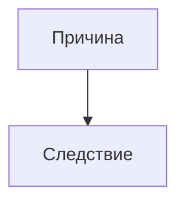

# Название статьи

## Вопрос

На какой вопрос отвечает статья. Одно-два предложения, без разогрева.

## Короткий ответ

Ответ целиком, в 3–5 предложениях. Чтобы человек, который не будет читать
дальше, уже получил пользу.

## Что известно

Основная часть. Делится на подзаголовки по смыслу, а не по книгам.

Каждое фактическое утверждение — со ссылкой на источник (S-XXX). Если
утверждение спорное, так и пишем: «данных мало», «это практика, а не
исследование».

### Подзаголовок 1

Текст.

### Подзаголовок 2

Текст.

## Схема

Схему подписываем одной строкой: что на ней видно.

## Что делать

Практические выводы. Конкретно, в виде шагов или списка. Без «будьте
увереннее в себе».

## Противоречия и пробелы

Обязательный раздел. Где источники спорят друг с другом, чего не хватает,
что проверить. Если противоречий нет — пишем, какого типа данных не
хватает всем источникам сразу.

## Источники

| Код | Источник | Что взято |
|---|---|---|
| S-000 | Автор, «Название», год | что именно использовано |

## История правок

| Дата | Что изменилось | Почему |
|---|---|---|
| YYYY-MM-DD | Статья создана | — |
